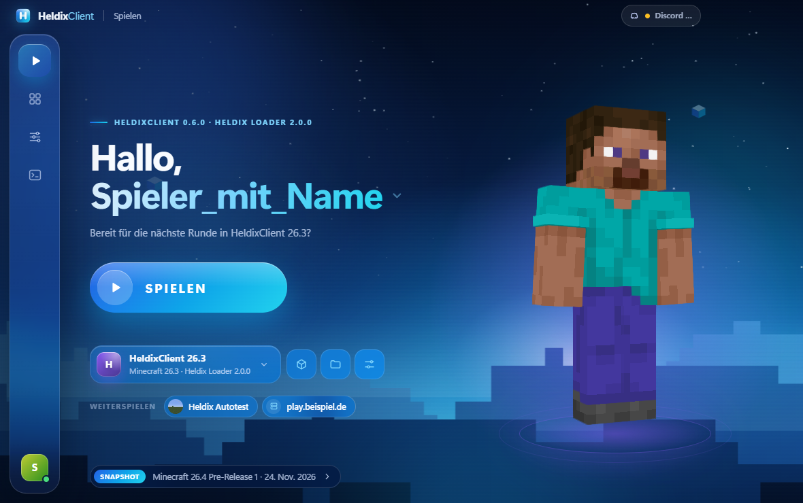
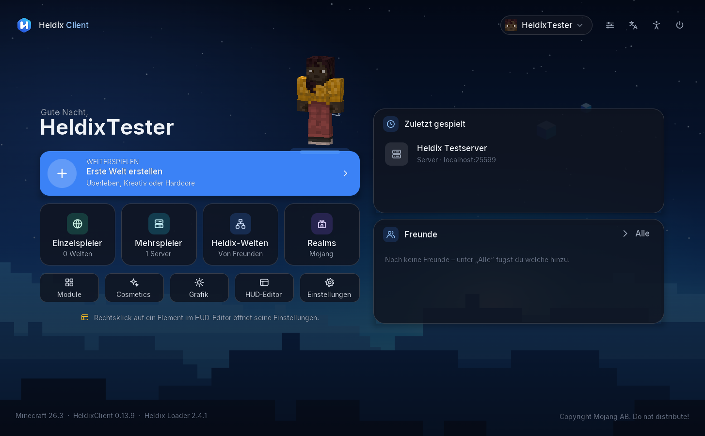

<div align="center">


# HeldixClient

**Minecraft-Launcher mit eigenem Mod-Loader, Client-Mod und Addon-System – ganz ohne Fabric.**

[](https://github.com/AMDRyzen753/HeldixClient/actions/workflows/build.yml)
[](LICENSE)




</div>

## Was ist HeldixClient?

Ein eigener Minecraft-Client nach dem Vorbild von Lunar oder Feather, bestehend aus vier Teilen:

| Teil | Was er macht |
| --- | --- |
| **Launcher** | Lädt Minecraft direkt von Mojang, verwaltet Instanzen und Konten und startet das Spiel. Electron + TypeScript. |
| **Heldix Loader** | Ein eigener Mod-Loader. Er klinkt sich als Java-Agent beim Start ein, verändert Minecraft-Klassen per ASM und lädt Heldix-Mods. |
| **HeldixClient-Mod** | Bringt die Features ins Spiel: eigenes Hauptmenü, Glas-Design für alle Menüs, HUD-Module, Zoom, Shader und ein eigenes F3-Menü. |
| **Heldix-Addons** | Kleine Erweiterungen über eine stabile API, die nach Minecraft-Updates ohne neuen Build weiterlaufen. |

Wer lieber Fabric-Mods von Modrinth nutzt, legt im Launcher einfach eine **Fabric-Instanz** an.

## Funktionen

**Launcher**
- Instanzen für jede Minecraft-Version, mit eigenen Welten, Mods, Addons und RAM-Einstellungen
- drei Loader zur Wahl: Heldix Loader, Fabric oder Vanilla
- Fabric-Mods direkt von Modrinth installieren, inklusive Abhängigkeiten
- Microsoft-Login; Tokens werden mit Windows-DPAPI verschlüsselt
- Offline-Konten mit eigenem Namen (für Einzelspieler, LAN und Offline-Server), sobald ein Microsoft-Konto mit Minecraft angemeldet ist
- passende Java-Version (8 bis 25) wird automatisch geladen
- **Vulkan als Standard** für Heldix-Instanzen ab Minecraft 26.x (mit automatischem Rückfall auf OpenGL) und abgestimmte Java-Einstellungen
- Aufgeräumte Startseite: große Begrüßung, ein Spielen-Button und dein Skin als drehbare 3D-Figur
- **Weiterspielen:** zuletzt gespielte Welten und Server mit einem Klick direkt betreten (Minecraft Quick Play)
- Neueste Minecraft-Patch-Notes mit einem Klick lesbar
- Discord-Status („Spielt HeldixClient – Spielt auf hypixel.net“)
- Spielkonsole mit Log

**Im Spiel**
- eigenes Hauptmenü mit Profil, Skin und Tipps
- Heldix-Design („Glas“) für alle Minecraft-Menüs, auf Wunsch abschaltbar
- Heldix-Menü (**Rechte Umschalttaste**), um Module an- und auszuschalten
- HUD-Module: FPS, CPS, Ping, Koordinaten, Richtung, Biom, Keystrokes
- HUD-Editor mit Einrasten an Rändern und anderen Elementen
- Zoom (**C** halten, Mausrad ändert die Stärke)
- **Shader:** acht Stile (Klar, Lebendig, Kino, Warm, Kühl, Hell, Schwarzweiß, Retro), mit Vulkan und OpenGL; HUD und Menüs bleiben unverändert
- **Leistung:** FPS-Boost (schnelle Grafikoptionen, Ausschalten stellt alles wieder her) und weniger FPS, solange das Fenster im Hintergrund ist
- **F3-Menü** im Heldix-Design, mit Grafik-API, Shader und Client-Version

**Für Entwickler**
- [Heldix-Mods](docs/heldix-loader.md#eine-heldix-mod-schreiben) mit Events, eigenen Tasten, Übersetzungen und eigenen Eingriffen in Minecraft-Code
- [Heldix-Addons](docs/addons.md) gegen eine einfache, versionsunabhängige API
- automatischer Test im echten Spiel, der sich durch alle Menüs klickt

## Screenshots

| | |
| :---: | :---: |
|  |  |
| Eigenes Hauptmenü | Heldix-Menü |
|  |  |
| Instanzen | Neue Instanz |

## Installation

1. Den Installer `HeldixClient-Setup-<version>.exe` unter [Releases](https://github.com/AMDRyzen753/HeldixClient/releases) herunterladen und starten.
2. Windows SmartScreen warnt beim ersten Start, weil der Installer nicht signiert ist: **Weitere Informationen** → **Trotzdem ausführen**.
3. Im Launcher mit dem Microsoft-Konto anmelden, eine Instanz wählen und **Spielen** drücken.

> [!NOTE]
> Die Anmeldung mit Microsoft-Konten braucht eine App-ID, die Mojang freigeschaltet hat. Solange die Freigabe aussteht, lehnt Minecraft die Anmeldung ab. Hintergründe stehen in [docs/einrichtung.md](docs/einrichtung.md).

## Selbst bauen

Voraussetzungen: Windows, [Node.js](https://nodejs.org) 22 oder neuer und ein JDK 25 (z. B. [Temurin](https://adoptium.net)).

```powershell
git clone https://github.com/AMDRyzen753/HeldixClient.git
cd HeldixClient\launcher
npm install
npm run mod      # baut Heldix Loader, Client-Mod und Addon
npm start        # startet den Launcher im Entwicklungsmodus
npm run dist     # erzeugt den Installer in launcher\release\
```

Beim ersten Bauen lädt Gradle die Minecraft-Client-JAR zum Kompilieren direkt von Mojang. Sie landet nur in `mod/.gradle/` und wird nie eingecheckt oder ausgeliefert.

Mehr dazu, inklusive Tests und Releases, steht in [docs/entwicklung.md](docs/entwicklung.md).

## Projektaufbau

```
launcher/                Electron-Launcher (TypeScript)
├── src/main/            Hauptprozess: Fenster, Konten, Einstellungen, Discord
│   └── core/            Launcher-Kern: Download, Java, Instanzen, Spielstart
├── src/renderer/        Oberfläche (HTML/CSS/TypeScript)
└── src/scripts/         Start-, Auto- und Discord-Test
mod/                     Java-Projekte (Gradle, Minecraft 26.3, Java 25)
├── heldix-loader/       der Heldix Loader (Java-Agent + ASM)
├── src/                 HeldixClient-Mod
├── heldix-api/          API für Heldix-Addons (ohne Minecraft-Abhängigkeit)
├── example-addon/       Beispiel-Addon „Uhrzeit & Spielzeit“
└── autotest/            automatischer Test im echten Spiel
docs/                    Dokumentation und Bilder
```

## Dokumentation

| Thema | Inhalt |
| --- | --- |
| [Heldix Loader](docs/heldix-loader.md) | Wie der Loader funktioniert, seine API und wie man eine Heldix-Mod schreibt |
| [Heldix-Addons](docs/addons.md) | Addons gegen die Heldix-API schreiben |
| [Einrichtung](docs/einrichtung.md) | Microsoft-Login und Discord-Status für eigene Builds einrichten |
| [Leistung](docs/leistung.md) | Vulkan, Java-Einstellungen, FPS-Boost, Shader, F3-Menü und Messwerte |
| [Entwicklung](docs/entwicklung.md) | Bauen, Testen, Releases, neue Minecraft-Versionen, Datenordner |

## Mitmachen

Fehler und Ideen gerne als [Issue](https://github.com/AMDRyzen753/HeldixClient/issues) melden. Wie du Änderungen beisteuerst, steht in [CONTRIBUTING.md](CONTRIBUTING.md).

## Rechtliches

HeldixClient ist **kein offizielles Minecraft-Produkt** und steht in keiner Verbindung zu Mojang oder Microsoft.

- Alle Minecraft-Dateien lädt der Launcher direkt von Mojang. Dieses Repository enthält und verteilt keine Minecraft-Dateien.
- Der Heldix Loader verändert Minecraft-Klassen nur beim Start im Arbeitsspeicher und speichert sie nicht.
- Viele Server verbieten Features, die einen Vorteil verschaffen. Im Zweifel die Server-Regeln prüfen.

Der Quellcode steht unter der [MIT-Lizenz](LICENSE).
