<div align="center">


# HeldixClient

**Minecraft-Launcher mit eigenem Mod-Loader, Client-Mod und Addon-System – ganz ohne Fabric.**

[](https://github.com/AMDRyzen753/HeldixClient/actions/workflows/build.yml)
[](LICENSE)


</div>

## Was ist HeldixClient?

Ein eigener Minecraft-Client nach dem Vorbild von Lunar oder Feather, bestehend aus vier Teilen:

| Teil | Was er macht |
| --- | --- |
| **Launcher** | Lädt Minecraft direkt von Mojang, verwaltet Instanzen und Konten und startet das Spiel. Electron + TypeScript. |
| **Heldix Loader** | Ein eigener Mod-Loader. Er klinkt sich als Java-Agent beim Start ein, verändert Minecraft-Klassen per ASM und lädt Heldix-Mods. Es gibt ihn auch als Fabric-Mod, damit HeldixClient in Fabric-Instanzen mitläuft. |
| **HeldixClient-Mod** | Bringt die Features ins Spiel: eigener Ladebildschirm, eigene Oberfläche (Startseite, Einzel-/Mehrspieler, Pausemenü, Heldix-Menü) mit eigener Schrift und eigenen Icons, HUD-Module, Zoom, Heldix-Shader und ein eigenes F3-Menü. |
| **Heldix-Addons** | Kleine Erweiterungen über eine stabile API, die nach Minecraft-Updates ohne neuen Build weiterlaufen. Einzeln aus dem **Addon-Store** (im Launcher, im Spiel und auf der Webseite, vom Team signiert), z. B. **Spotify** (Song mit Cover im HUD, Musik per Taste steuern), **Uhrzeit & Spielzeit** und **Item Physics** (Items liegen flach am Boden). |

Wer Fabric-Mods wie Sodium oder Shaderpacks wie BSL nutzen möchte, legt im Launcher eine **Fabric-Instanz** an. HeldixClient läuft dort mit (abschaltbar).

## Funktionen

**Launcher**
- Instanzen für jede Minecraft-Version, mit eigenen Welten, Mods, Addons und RAM-Einstellungen
- drei Loader zur Wahl: Heldix Loader, Fabric oder Vanilla
- Fabric-Mods direkt von Modrinth installieren, inklusive Abhängigkeiten
- **Shaderpacks** wie BSL, Complementary oder Photon für Fabric-Instanzen: Suche auf Modrinth, Iris und Sodium kommen automatisch mit
- **HeldixClient auch in Fabric-Instanzen** (HUD, Menü, Addons zusammen mit Sodium, Iris & Co.) und ein **Leistungs-Paket** mit einem Klick: Sodium, Lithium, FerriteCore, ImmediatelyFast, Entity Culling, More Culling
- Prüfung vor jedem Start, ob die Fabric-Mods zusammenpassen; unverträgliche Zusatz-Mods schaltet der Launcher mit Hinweis ab
- Microsoft-Login; Tokens werden mit Windows-DPAPI verschlüsselt
- Mehrere Microsoft-Konten, Wechsel mit einem Klick (Offline-Konten gibt es nur in der Entwicklungsversion)
- passende Java-Version (8 bis 25) wird automatisch geladen
- **Vulkan als Standard** für Heldix-Instanzen ab Minecraft 26.x (mit automatischem Rückfall auf OpenGL) und abgestimmte Java-Einstellungen
- **Gleiches Design wie im Spiel:** Schrift Inter, dieselben Icons, ruhiges Dunkel mit Blau; Seitenleiste mit Text (in schmalen Fenstern nur Icons)
- Startseite: großer Spielen-Knopf mit Instanz-Auswahl und deinem Skin als drehbare 3D-Figur, Schnellzugriff auf Mods, Shader, Ordner und Einstellungen der Instanz
- **Weiterspielen:** zuletzt gespielte Welten und Server mit einem Klick direkt betreten (Minecraft Quick Play)
- zuletzt gespielte Instanzen direkt auf der Startseite wählen oder starten
- **Einrichtung beim ersten Start:** Willkommen (mit Einladung, falls vorhanden), Microsoft-Anmeldung und nur offizielle HeldixClient-Addons zum Vorinstallieren; der Windows-Installer im HeldixClient-Design
- **Zusammen spielen auf der Startseite:** offene Welten deiner Freunde und Freunde online mit „Beitreten“ (wählt die passende Instanz), Glocke mit allen Benachrichtigungen; während des Spiels bleibt der Launcher auf Wunsch im Infobereich
- Neueste Minecraft-Patch-Notes mit Vorschaubild, mit einem Klick lesbar
- **Discord-Status** mit Dimension, Spielmodus, Spielerzahl, Voice, geteilter Welt, Party und „Abwesend“, passenden Bildern und dem eigenen Minecraft-Kopf; jeder Teil einzeln abschaltbar, mit Vorschau
- **Automatische Updates** über die Schnittstelle von heldixclient.com: unter Windows prüft der Launcher beim Start, installiert eine neue Version gleich still und startet neu; im laufenden Launcher alle 30 Minuten, mit „Jetzt neu starten“ oder beim Beenden. Jede Version ist mit einem eigenen Schlüssel signiert; der Launcher nimmt nur geprüfte, neuere Installer an
- Spielkonsole mit Log

**Im Spiel**
- eigener Ladebildschirm im Heldix-Design statt des Mojang-Logos; beim Laden einer Welt und beim Verbinden mit einem Server eine Tipp-Karte mit der eigenen Spielfigur
- **eigene Oberfläche statt Minecraft-Optik:** moderne Schrift (Inter), weiche, kantengeglättete Flächen und Schatten, ein eigenes Icon-Set und der Hintergrund des Launchers
- **Startseite:** Begrüßung mit der eigenen Spielfigur samt Cape (Klick öffnet die Cape-Auswahl; in kleinen Fenstern steht sie groß neben den Kacheln), „Weiterspielen“ mit Vorschaubild der letzten Welt oder dem letzten Server samt Live-Stand (Spieler online, Ping), Kacheln für Einzelspieler, Mehrspieler, Heldix-Welten und Realms, beschriftete Wege zu Modulen, Cosmetics, Grafik, HUD-Editor und Einstellungen – auch in kleinen Fenstern nichts abgeschnitten; in breiten Fenstern daneben „Zuletzt gespielt“ und „Freunde“ mit Online-Status, sonst eine Freunde-Zeile mit Party und offenen Welten
- **Ein Fenster für alles:** Einzelspieler, Mehrspieler, Heldix-Menü und Pausemenü teilen sich eine Seitenleiste mit Ober-Kategorien in Gruppen (Spielen, Heldix, Profil, System); Kategorien mit mehreren Bereichen haben ihre Unter-Menüs als Reiter unter dem Seitentitel, z. B. Grafik → Shader, Leistung oder Freunde → Freunde, Anfragen, Privatsphäre. Offene Freundschaftsanfragen stehen als Zahl in der Seitenleiste
- eigene **Einzelspieler- und Mehrspieler-Seiten** mit Suche, Welt- und Server-Symbolen, Ping-Balken, Spielerliste beim Darüberfahren und Spielen/Bearbeiten/Löschen direkt in der Liste; Server ohne eigenen Namen zeigen ihre Adresse; die klassische Minecraft-Ansicht bleibt einen Klick entfernt
- eigenes **Pausemenü** mit Servername und Adresse (mit einem Klick kopieren), Schnellschaltern für bis zu zwölf Module (Dauersprint, Freelook, Fadenkreuz, Wegpunkte, Zoom …), Schaltern für Mikrofon und Ton des Voice Chats und Karten für die Sitzung (Spielzeit, Position, Ping – auch auf Servern, die in der Tab-Liste keinen melden – bzw. Spielmodus), Freunde mit „Freunde einladen“ (im Mehrspieler direkt auf den eigenen Server) und Party sowie „Wegpunkt hier setzen“; das von Minecraft (mit Knöpfen anderer Mods) bleibt über „Klassisches Pausemenü“ erreichbar. Minecrafts Hinweis zu nicht überprüfbaren Chatnachrichten erscheint als Heldix-Einblendung statt über den Menüs
- Heldix-Menü (**Rechte Umschalttaste**): Übersicht mit Spielfigur und Karten für Freunde, Wegpunkte, aktive Module und Tasten; Module als Kacheln mit Icons, Reitern (Alle, HUD, Funktionen, Addons), Suche und einem Untermenü pro Modul (z. B. Größe, Farben, Anzeige); Einstellungen in Gruppen-Karten statt einer langen Liste
- übrige Minecraft-Menüs (Optionen usw.) mit passenden Knöpfen und Hintergrund; alles auf Wunsch abschaltbar
- HUD-Module: FPS, CPS, Ping, Koordinaten, Richtung, Biom, Keystrokes, **Rüstung** (Rüstung und Items in der Hand mit Haltbarkeit, farbig je nach Zustand), **Trank-Effekte** (Symbol, Stufe und Restzeit; kurz vor dem Ende blinkt der Eintrag)
- **Dauersprint und Dauerschleichen:** Sprinten ohne Taste (Sprinttaste schaltet um), Schleichen per Tastendruck umschalten; Minecraft entscheidet weiter, wann gesprintet werden darf
- **Freelook** (**Linke Alt** halten): frei umschauen, während der Spieler weiter in seine Richtung läuft; auf Servern, deren Regeln es verbieten (z. B. hypixel.net), bleibt es aus
- **Fadenkreuz-Editor:** sechs Formen, acht Farben, Größe, Dicke, Lücke, Deckkraft, Umrandung und Rot beim Zielen auf Lebewesen
- **Chat:** Uhrzeit vor jeder Nachricht, gleiche Nachrichten hintereinander als „(3×)“ zusammengefasst, Strg+Klick kopiert eine Nachricht
- **Wegpunkte** (**B** setzt einen): Markierung mit Name und Entfernung, auch durch Wände; automatischer Todespunkt; Verwalten unter Heldix-Menü → Wegpunkte (Farbe, Ausblenden, Löschen)
- **Freunde, Capes für alle und Heldix-Symbol** über den [Heldix-Dienst](docs/dienst.md): Freundesliste mit Anfragen und Online-Status (auf Wunsch mit Server), andere HeldixClient-Spieler sehen dein Heldix-Cape, und in der Tab-Liste und über ihren Köpfen steht das Heldix-Logo vor ihrem Namen (eigenes Symbol für Team und Addon-Entwickler)
- **Abzeichen** als Sechseck-Symbole für die Team-Rollen Admin, Entwickler, Moderator, Supporter, Designer und Tester, für Addon-Entwickler und für die Community (Partner, Creator, Botschafter) – in der Tab-Liste, über Köpfen, in der Freundesliste und auf der Profilkarte
- **Beitreten:** Spielt ein Freund auf einem öffentlichen Server oder in einer geteilten Welt, bringt dich „Beitreten“ in der Freundesliste direkt dorthin (aus einer Welt heraus nach einer Rückfrage)
- **Welt teilen:** die eigene Einzelspielerwelt im Pausenmenü mit einem Klick öffnen – kostenlos, ohne Portfreigabe, mit fester Adresse wie `k7m2xq.welt.heldixclient.com`, der auch Spieler ohne HeldixClient beitreten können; die IP-Adressen der Mitspieler sieht der Gastgeber nicht. Im Hauptmenü **Heldix-Welten** mit den offenen Welten der Freunde, eigenen Welten, Mitgliedern und Rollen, Anklopfen (**H** erlauben, **N** ablehnen) und automatischen Sicherungen
- **Party** mit bis zu 7 Freunden: sehen, wo jeder spielt, Party-Chat, dem Leiter folgen und automatisch eine gemeinsame Voice-Gruppe
- **Einladen:** eigener Link unter Freunde → Einladen; Neue sind gleich befreundet, Belohnungen (Freundesfunken, Cape Freundesband) für bestätigte Freunde. Freunde ohne HeldixClient reden über einen Gast-Link im Browser im Voice Chat mit
- **Nachrichten** zwischen Freunden im Heldix-Menü (Freunde → Nachrichten), mit Einblendung im Spiel und Zahl der ungelesenen in der Seitenleiste; Antworten, Reaktionen, Löschen, „schreibt …“ und Beitreten-Karten; Nachrichten liegen höchstens 30 Tage beim Dienst. Dazu Favoriten, Spitznamen und Notizen nur für dich, eigener Status mit „Nicht stören“, **Blockieren** (Chat, Anfragen) und **Melden** (mit den letzten Nachrichten an den Betreiber)
- **Konto auf heldixclient.com** ohne Passwort: Im Launcher (Konto-Menü) oder im Heldix-Menü „Auf heldixclient.com anmelden“ öffnet die Webseite schon angemeldet. Dort: Übersicht, Profil und Cosmetics, Freunde, Nachrichten und Party in Echtzeit, „Meine Welten“, Einladen, Privatsphäre, Blockierte und eigene Meldungen, alle Daten als Datei und Konto löschen
- **Team-Bereich** auf der Webseite (nur mit Zwei-Faktor-Code): Übersicht je nach Rolle, Meldungen und Support, Spieler sperren und verwalten (mit Zeitleiste), Neuigkeiten für Webseite und Launcher schreiben, Updates, Addons und Cosmetics veröffentlichen (nur signierte), Teammitglieder mit den Rollen Admin, Entwickler, Moderator, Supporter, Designer und Tester (Rechte je Rolle) und Community-Abzeichen verwalten, Schnellsuche (Strg+K), Protokoll aller Team-Aktionen
- **Support:** Spieler schreiben dem Team über ihr Konto (aus dem Launcher und dem Spiel unter „Hilfe & Support“ direkt erreichbar); Antworten werden im Spiel eingeblendet
- **Öffentliche Seiten:** Teamseite (nur Mitglieder, die zustimmen, mit Minecraft-Kopf), Neuigkeiten mit Versionsverlauf, Statusseite; nach einem Update zeigt der Launcher „Was ist neu“, die neuesten Neuigkeiten stehen auch in der Übersicht im Spiel
- HUD-Editor mit Werkzeugleiste: Einrasten an Rändern und anderen Elementen (Umschalt = frei), Raster, Größe über die Ecke oder das Mausrad, Elemente-Liste zum Ein- und Ausblenden, Pfeiltasten, Rückgängig (Strg+Z); Rechtsklick öffnet die Einstellungen eines Elements
- Zoom (**C** halten, Mausrad ändert die Stärke)
- **Heldix-Shader:** acht Farbstile und eine Shader-Engine mit Bloom, Tiefenunschärfe, Nebel und Umgebungsverdeckung (SSAO), mit Vulkan und OpenGL; HUD und Menüs bleiben unverändert
- **Leistung:** FPS-Boost (schnelle Grafikoptionen, Ausschalten stellt alles wieder her) und weniger FPS, solange das Fenster im Hintergrund ist
- **F3-Menü** im Heldix-Design, mit Grafik-API, Shader und Client-Version
- **Capes:** 13 animierte Heldix-Capes in hoher Auflösung (Heldix, Mitternacht, Aurora, Glut, Kristall, Neon, Sakura, Gewitter, Galaxie, Matrix und – nur fürs Team – Matrix Rot, Matrix Türkis und Sakura Orange) mit Zierkante – Flammen flackern, Sterne funkeln, Blitze zucken, und leuchtende Teile strahlen auch nachts. Das Cape weht wie Stoff: Es biegt sich, wirft Wellen und flattert beim Laufen, ruhig und ohne durch Körper oder Beine zu stechen (für alle Capes, abschaltbar). Dazu eigene Bilder per Drag & Drop, eine drehende Vorschau der eigenen Spielfigur und auf Wunsch dasselbe Motiv auf der Elytra – in echter Flügelform, bei Aurora, Mitternacht, Glut und Galaxie mit eigener Form. Sichtbar für dich (z. B. mit F5)
- **Cosmetics** aus dem Katalog des Heldix-Dienstes, für alle HeldixClient-Spieler sichtbar: Hüte, Flügel und Rückenteile, Begleiter und Auren – viele animiert, sie bewegen sich beim Laufen, Schleichen, Schwimmen und Fliegen mit und leuchten teils im Dunkeln; jede Datei ist signiert
- **Addon-Store** im Launcher, auf der Webseite und im Spiel mit offiziellen Addons wie Voice Chat (Nähe, Gruppen, Browser-Gäste), Minimap, Emote-Rad, Item Physics, Uhrzeit und Spotify; Addons von Entwicklern werden vom Team geprüft und signiert
- **Spotify-Addon:** laufender Song mit Cover und Fortschritt im HUD, Abspielen/Pause und Songwechsel per Taste (Pos1, Bild ab/auf), Einblendung bei jedem neuen Song – ohne Anmeldung, über die Windows-Mediensteuerung

**Für Entwickler**
- [Heldix-Mods](docs/heldix-loader.md#eine-heldix-mod-schreiben) mit Events, eigenen Tasten, Übersetzungen und eigenen Eingriffen in Minecraft-Code
- [Heldix-Addons](docs/addons.md) gegen eine einfache, versionsunabhängige API
- automatischer Test im echten Spiel, der sich durch alle Menüs klickt

## Screenshots

| | |
| :---: | :---: |
|  | 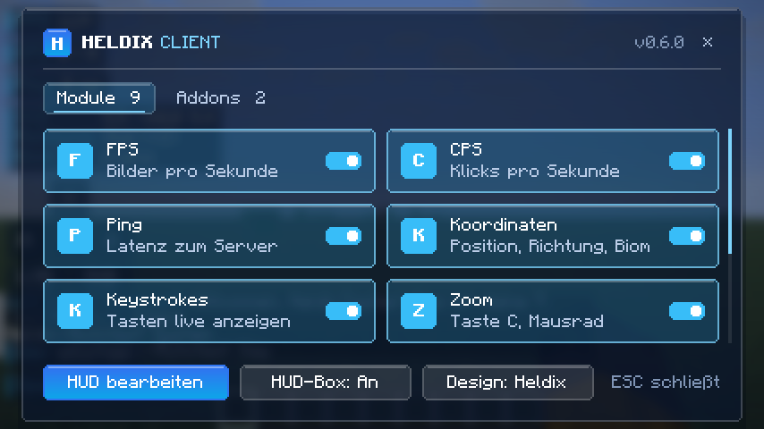 |
| Startseite | Heldix-Menü |
| 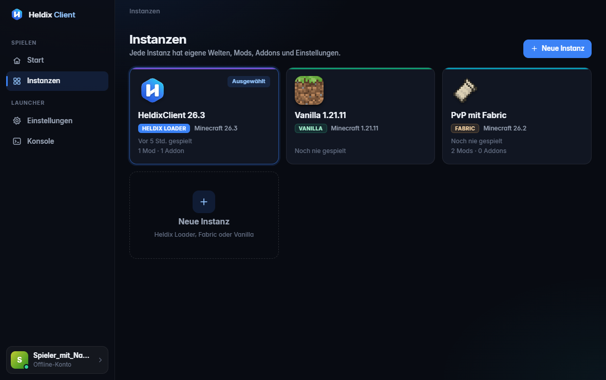 |  |
| Instanzen | Neue Instanz |
| 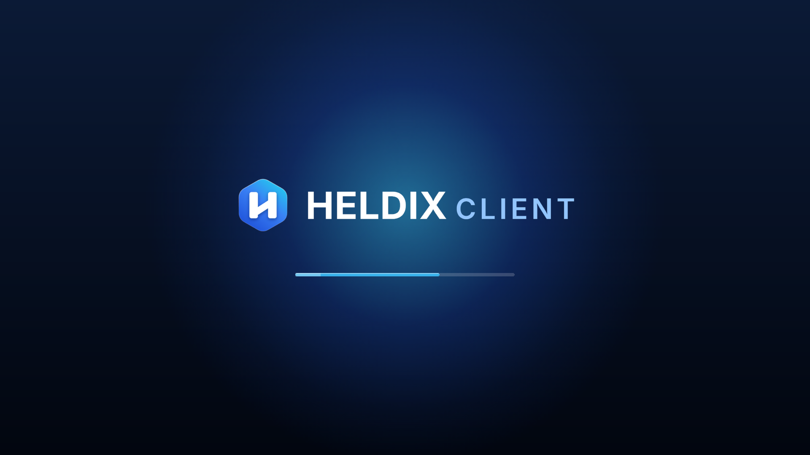 | 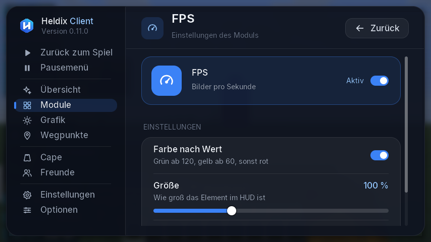 |
| Ladebildschirm | Untermenü eines Moduls |
| 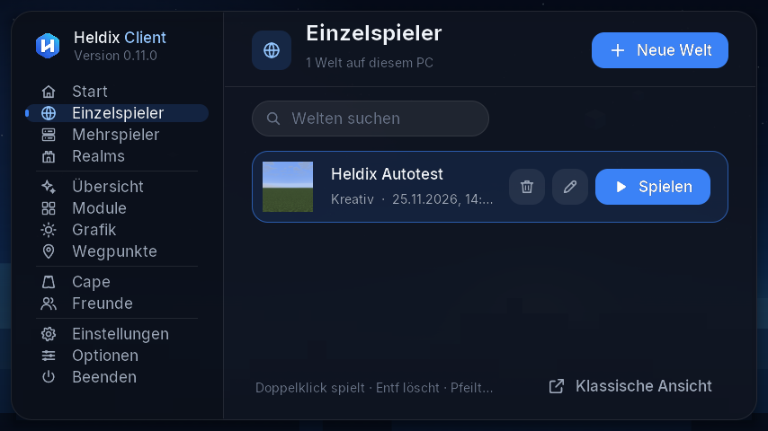 |  |
| Einzelspieler | Mehrspieler |
|  |  |
| HUD-Editor | Shader: Farbstile und Shader-Engine |
| 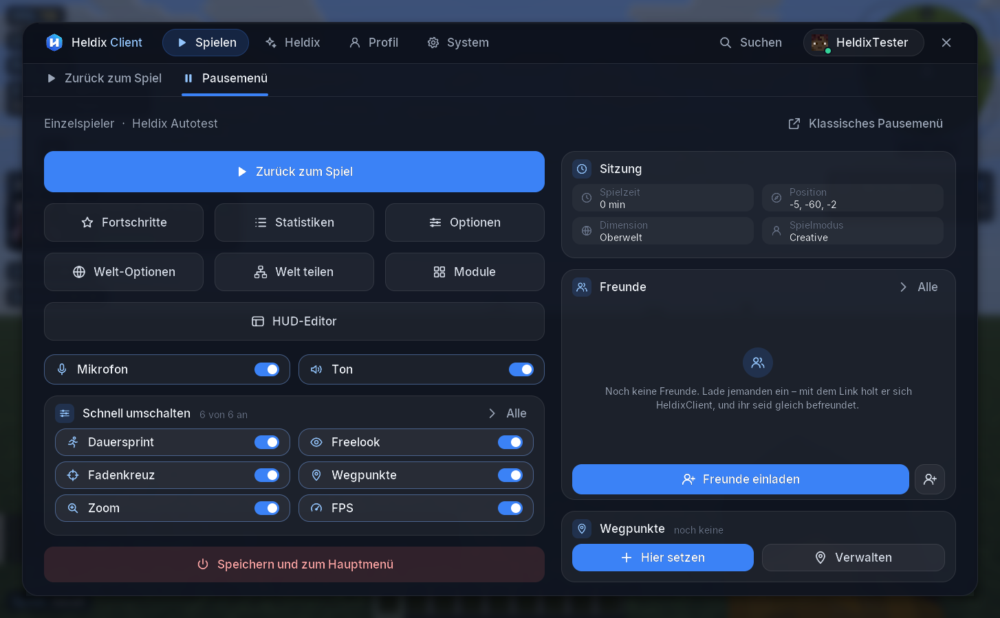 | 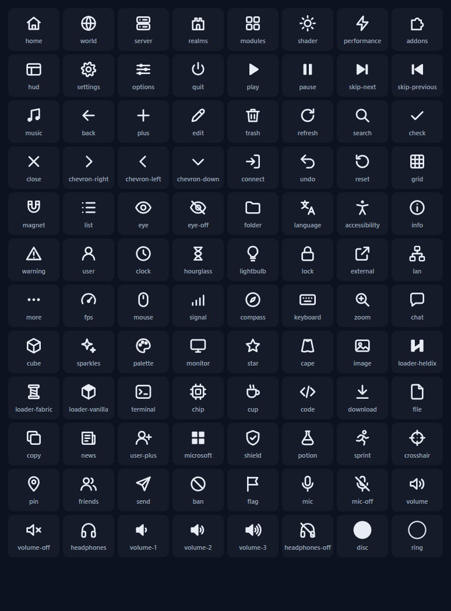 |
| Pausemenü | Eigenes Icon-Set |
| 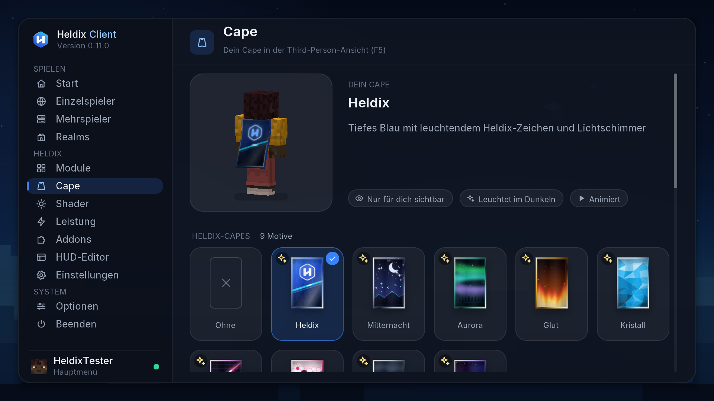 | 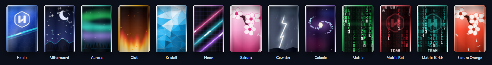 |
| Cape mit Vorschau der eigenen Figur | Die Heldix-Capes |
| 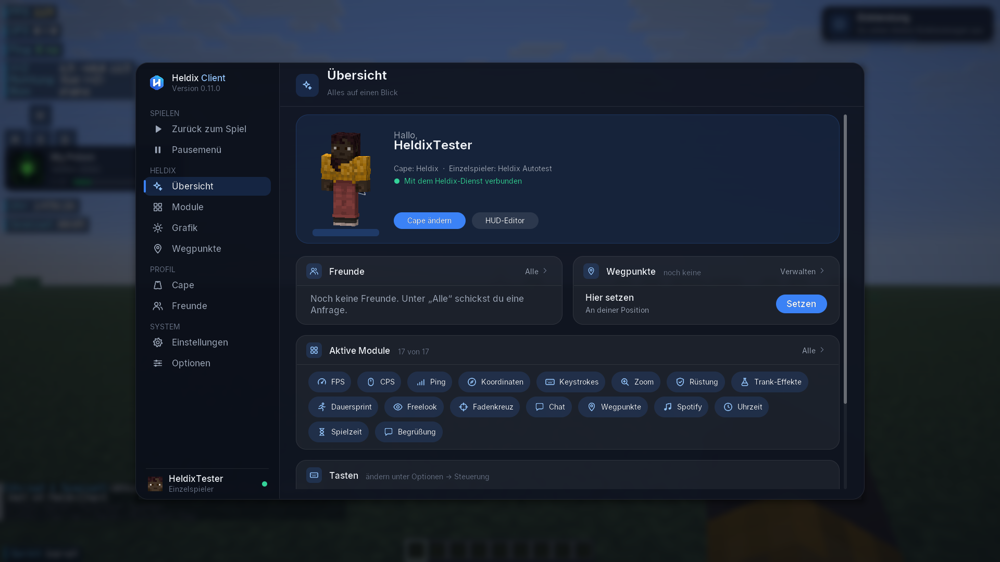 | 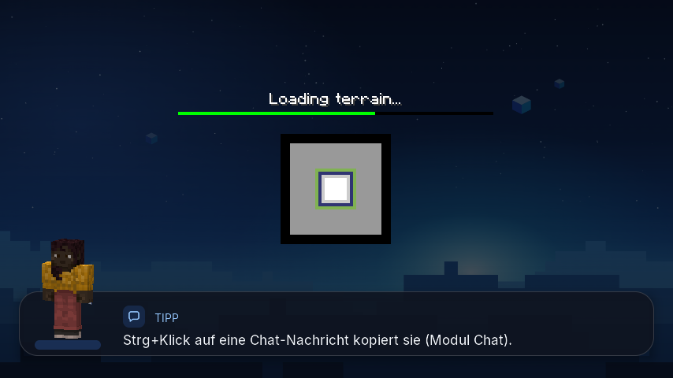 |
| Übersicht im Heldix-Menü | Welt laden: Tipp mit Spielfigur |
| 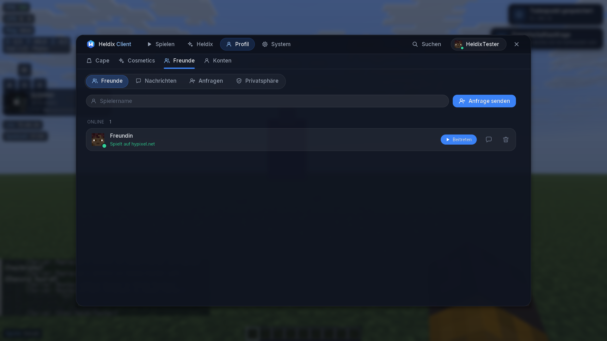 | 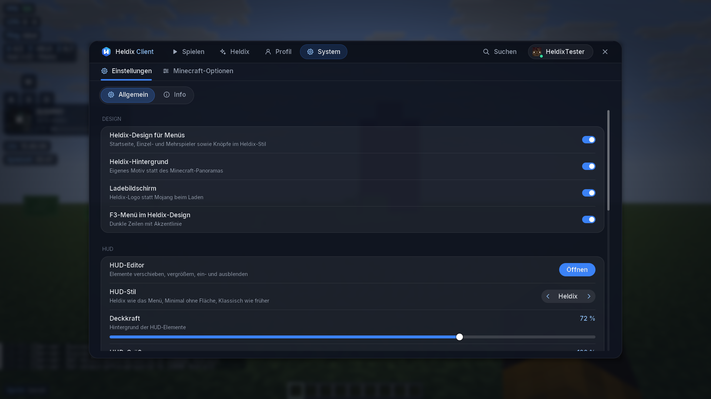 |
| Freunde: Reiter für Anfragen und Privatsphäre | Einstellungen in Gruppen |

## Installation

**Windows 10 und 11**
1. Den Installer `HeldixClient-Setup-<version>.exe` auf [heldixclient.com/download](https://heldixclient.com/download) herunterladen und starten.
2. Windows SmartScreen warnt beim ersten Start, weil der Installer nicht signiert ist: **Weitere Informationen** → **Trotzdem ausführen**.
3. Im Launcher mit dem Microsoft-Konto anmelden, eine Instanz wählen und **Spielen** drücken.

**macOS 11 oder neuer** (Apple Silicon und Intel)
1. Auf [heldixclient.com/download](https://heldixclient.com/download) die Mac-Version laden (Apple Silicon für M1 und neuer, sonst Intel), öffnen und HeldixClient in **Programme** ziehen.
2. Die App ist nur ad-hoc signiert und nicht von Apple beglaubigt. Beim ersten Start blockiert macOS sie; unter **Systemeinstellungen → Datenschutz & Sicherheit** steht dann **Dennoch öffnen**.
3. Anmelden und spielen wie unter Windows. Unterschiede: Vulkan gibt es auf dem Mac nicht (Minecraft wählt die Grafik selbst), Updates meldet der Launcher nur und lädt sie nicht selbst, und das Spotify-Addon braucht Windows.

> [!NOTE]
> Die Anmeldung mit Microsoft-Konten braucht eine App-ID, die Mojang freigeschaltet hat. Die App-ID von HeldixClient ist seit November 2026 freigegeben. Wer einen eigenen Build mit eigener App-ID ausliefert, muss sie selbst freischalten lassen, siehe [docs/einrichtung.md](docs/einrichtung.md).

## Selbst bauen

Voraussetzungen: Windows oder macOS, [Node.js](https://nodejs.org) 22 oder neuer und ein JDK 25 (z. B. [Temurin](https://adoptium.net)).

```powershell
git clone https://github.com/AMDRyzen753/HeldixClient.git
cd HeldixClient\launcher
npm install
npm run mod      # baut Heldix Loader und Client-Mod (Addons: npm run addon -- <id>, siehe docs/addons.md)
npm start        # startet den Launcher im Entwicklungsmodus
npm run dist     # erzeugt den Installer in launcher\release\
npm run dist:mac # nur auf einem Mac: DMG und ZIP für Apple Silicon und Intel
```

Die Mac-App baut auch GitHub Actions bei jedem Push (Job „macOS-App bauen“) und hängt sie bei einem Versions-Tag an das Release.

Beim ersten Bauen lädt Gradle die Minecraft-Client-JAR zum Kompilieren direkt von Mojang. Sie landet nur in `mod/.gradle/` und wird nie eingecheckt oder ausgeliefert.

Mehr dazu, inklusive Tests und Releases, steht in [docs/entwicklung.md](docs/entwicklung.md).

## Projektaufbau

```
launcher/                Electron-Launcher (TypeScript)
├── src/main/            Hauptprozess: Fenster, Konten, Einstellungen, Discord
│   └── core/            Launcher-Kern: Download, Java, Instanzen, Spielstart
├── src/renderer/        Oberfläche (HTML/CSS/TypeScript)
└── src/scripts/         Start-, Auto- und Discord-Test
mod/                     Java-Projekte (Gradle, Minecraft 26.3, Java 25)
├── heldix-loader/       der Heldix Loader (Java-Agent + ASM)
├── heldix-loader-fabric/ derselbe Loader als Fabric-Mod (für HeldixClient in Fabric-Instanzen)
├── src/                 HeldixClient-Mod
├── heldix-api/          API für Heldix-Addons (ohne Minecraft-Abhängigkeit)
├── addons/uhrzeit/      Addon „Uhrzeit & Spielzeit“ (auch Vorlage), kommt über den Addon-Store
├── addons/spotify/      Spotify-Addon (Windows-Mediensteuerung), kommt über den Addon-Store
├── addons/itemphysics/  Addon „Item Physics“ (gedroppte Items liegen flach, API 4), kommt über den Addon-Store
service/                 Heldix-Dienst: Freunde, Capes für alle, Heldix-Symbol (Node.js) und Server-Installer
website/                 Webseite (Startseite, Download, Impressum, Datenschutz)
└── autotest/            automatischer Test im echten Spiel
docs/                    Dokumentation und Bilder
```

## Dokumentation

| Thema | Inhalt |
| --- | --- |
| [Heldix Loader](docs/heldix-loader.md) | Wie der Loader funktioniert, seine API und wie man eine Heldix-Mod schreibt |
| [Heldix-Addons](docs/addons.md) | Addons gegen die Heldix-API schreiben |
| [Einrichtung](docs/einrichtung.md) | Microsoft-Login und Discord-Status für eigene Builds einrichten |
| [Leistung](docs/leistung.md) | Vulkan, Java-Einstellungen, FPS-Boost, Shader, F3-Menü und Messwerte |
| [Entwicklung](docs/entwicklung.md) | Bauen, Testen, Releases, neue Minecraft-Versionen, Datenordner |

## Mitmachen

Fehler und Ideen gerne als [Issue](https://github.com/AMDRyzen753/HeldixClient/issues) melden. Wie du Änderungen beisteuerst, steht in [CONTRIBUTING.md](CONTRIBUTING.md).

## Rechtliches

HeldixClient ist **kein offizielles Minecraft-Produkt** und steht in keiner Verbindung zu Mojang oder Microsoft.

- Alle Minecraft-Dateien lädt der Launcher direkt von Mojang. Dieses Repository enthält und verteilt keine Minecraft-Dateien.
- Der Heldix Loader verändert Minecraft-Klassen nur beim Start im Arbeitsspeicher und speichert sie nicht.
- Die Logos von Minecraft (Grasblock) und Fabric auf den Instanz-Kacheln liest der Launcher aus den Dateien im Datenordner (Minecraft-Client bzw. Fabric Loader, falls nötig einmal von Fabrics Maven-Server geladen). Sie gehören ihren Rechteinhabern und liegen nicht in diesem Repository.
- Viele Server verbieten Features, die einen Vorteil verschaffen. Im Zweifel die Server-Regeln prüfen.

Der Quellcode steht unter der [MIT-Lizenz](LICENSE). Die Schrift [Inter](https://github.com/rsms/inter) (in der Client-Mod) steht unter der SIL Open Font License 1.1, siehe [Inter-OFL.txt](mod/src/main/resources/licenses/Inter-OFL.txt).
