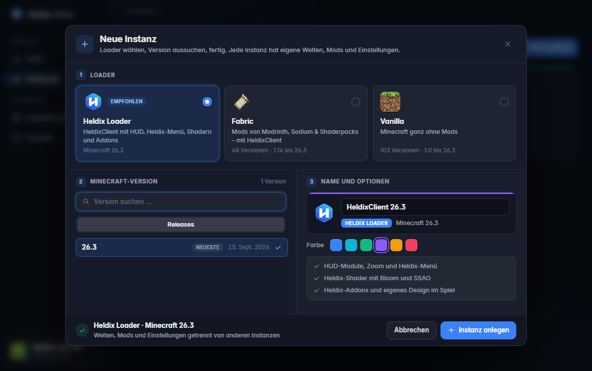
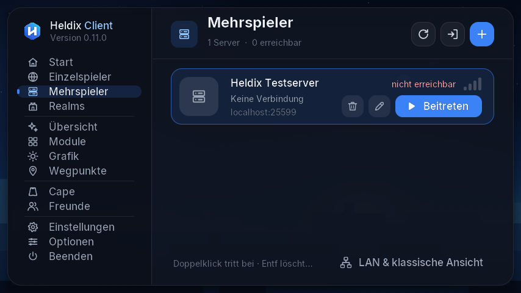
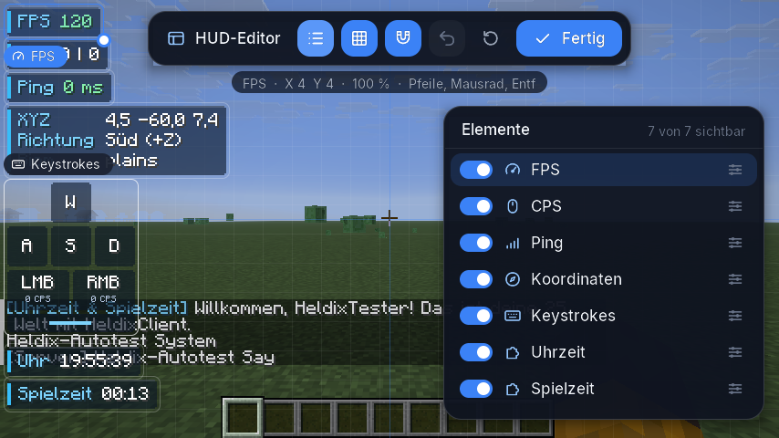

<div align="center">


# HeldixClient

**Minecraft-Launcher mit eigenem Mod-Loader, Client-Mod und Addon-System – ganz ohne Fabric.**

[](https://github.com/AMDRyzen753/HeldixClient/actions/workflows/build.yml)
[](LICENSE)


</div>

## Was ist HeldixClient?

Ein eigener Minecraft-Client nach dem Vorbild von Lunar oder Feather, bestehend aus vier Teilen:

| Teil | Was er macht |
| --- | --- |
| **Launcher** | Lädt Minecraft direkt von Mojang, verwaltet Instanzen und Konten und startet das Spiel. Electron + TypeScript. |
| **Heldix Loader** | Ein eigener Mod-Loader. Er klinkt sich als Java-Agent beim Start ein, verändert Minecraft-Klassen per ASM und lädt Heldix-Mods. Es gibt ihn auch als Fabric-Mod, damit HeldixClient in Fabric-Instanzen mitläuft. |
| **HeldixClient-Mod** | Bringt die Features ins Spiel: eigener Ladebildschirm, eigene Oberfläche (Startseite, Einzel-/Mehrspieler, Pausemenü, Heldix-Menü) mit eigener Schrift und eigenen Icons, HUD-Module, Zoom, Heldix-Shader und ein eigenes F3-Menü. |
| **Heldix-Addons** | Kleine Erweiterungen über eine stabile API, die nach Minecraft-Updates ohne neuen Build weiterlaufen. Mitgeliefert: **Spotify** (Song mit Cover im HUD, Musik per Taste steuern) und **Uhrzeit & Spielzeit**. |

Wer Fabric-Mods wie Sodium oder Shaderpacks wie BSL nutzen möchte, legt im Launcher eine **Fabric-Instanz** an. HeldixClient läuft dort mit (abschaltbar).

## Funktionen

**Launcher**
- Instanzen für jede Minecraft-Version, mit eigenen Welten, Mods, Addons und RAM-Einstellungen
- drei Loader zur Wahl: Heldix Loader, Fabric oder Vanilla
- Fabric-Mods direkt von Modrinth installieren, inklusive Abhängigkeiten
- **Shaderpacks** wie BSL, Complementary oder Photon für Fabric-Instanzen: Suche auf Modrinth, Iris und Sodium kommen automatisch mit
- **HeldixClient auch in Fabric-Instanzen** (HUD, Menü, Addons zusammen mit Sodium, Iris & Co.) und ein **Leistungs-Paket** mit einem Klick: Sodium, Lithium, FerriteCore, ImmediatelyFast, Entity Culling, More Culling
- Prüfung vor jedem Start, ob die Fabric-Mods zusammenpassen; unverträgliche Zusatz-Mods schaltet der Launcher mit Hinweis ab
- Microsoft-Login; Tokens werden mit Windows-DPAPI verschlüsselt
- Offline-Konten mit eigenem Namen (für Einzelspieler, LAN und Offline-Server), sobald ein Microsoft-Konto mit Minecraft angemeldet ist – oder mit Entwickleroptionen und [Entwickler-Schlüssel](docs/entwicklung.md#entwickleroptionen-in-der-fertigen-app)
- passende Java-Version (8 bis 25) wird automatisch geladen
- **Vulkan als Standard** für Heldix-Instanzen ab Minecraft 26.x (mit automatischem Rückfall auf OpenGL) und abgestimmte Java-Einstellungen
- **Gleiches Design wie im Spiel:** Schrift Inter, dieselben Icons, ruhiges Dunkel mit Blau; Seitenleiste mit Text (in schmalen Fenstern nur Icons)
- Startseite: großer Spielen-Knopf mit Instanz-Auswahl und deinem Skin als drehbare 3D-Figur, Schnellzugriff auf Mods, Shader, Ordner und Einstellungen der Instanz
- **Weiterspielen:** zuletzt gespielte Welten und Server mit einem Klick direkt betreten (Minecraft Quick Play)
- zuletzt gespielte Instanzen direkt auf der Startseite wählen oder starten
- Neueste Minecraft-Patch-Notes mit Vorschaubild, mit einem Klick lesbar
- Discord-Status („Spielt HeldixClient – Spielt auf hypixel.net“)
- Spielkonsole mit Log

**Im Spiel**
- eigener Ladebildschirm im Heldix-Design statt des Mojang-Logos
- **eigene Oberfläche statt Minecraft-Optik:** moderne Schrift (Inter), weiche, kantengeglättete Flächen und Schatten, ein eigenes Icon-Set und der Hintergrund des Launchers
- **Startseite:** Begrüßung, „Weiterspielen“ mit Vorschaubild der letzten Welt (oder dem letzten Server), Kacheln für Einzelspieler, Mehrspieler und Realms, direkte Wege zu Modulen, Shader, HUD-Editor und Einstellungen; in breiten Fenstern daneben „Zuletzt gespielt“ mit Welten und Servern zum direkten Starten
- **Ein Fenster für alles:** Einzelspieler, Mehrspieler, Heldix-Menü und Pausemenü teilen sich eine Seitenleiste mit Icons
- eigene **Einzelspieler- und Mehrspieler-Seiten** mit Suche, Welt- und Server-Symbolen, Ping-Balken, Spielerliste beim Darüberfahren und Spielen/Bearbeiten/Löschen direkt in der Liste; Server ohne eigenen Namen zeigen ihre Adresse; die klassische Minecraft-Ansicht bleibt einen Klick entfernt
- eigenes **Pausemenü**; das von Minecraft (mit Knöpfen anderer Mods) bleibt über „Klassisches Pausemenü“ erreichbar
- Heldix-Menü (**Rechte Umschalttaste**): Module als Kacheln mit Icons, Filter (HUD, Funktionen, Addons), Suche und ein Untermenü pro Modul (z. B. Größe, Farben, Anzeige)
- übrige Minecraft-Menüs (Optionen usw.) mit passenden Knöpfen und Hintergrund; alles auf Wunsch abschaltbar
- HUD-Module: FPS, CPS, Ping, Koordinaten, Richtung, Biom, Keystrokes
- HUD-Editor mit Werkzeugleiste: Einrasten an Rändern und anderen Elementen (Umschalt = frei), Raster, Größe über die Ecke oder das Mausrad, Elemente-Liste zum Ein- und Ausblenden, Pfeiltasten, Rückgängig (Strg+Z); Rechtsklick öffnet die Einstellungen eines Elements
- Zoom (**C** halten, Mausrad ändert die Stärke)
- **Heldix-Shader:** acht Farbstile und eine Shader-Engine mit Bloom, Tiefenunschärfe, Nebel und Umgebungsverdeckung (SSAO), mit Vulkan und OpenGL; HUD und Menüs bleiben unverändert
- **Leistung:** FPS-Boost (schnelle Grafikoptionen, Ausschalten stellt alles wieder her) und weniger FPS, solange das Fenster im Hintergrund ist
- **F3-Menü** im Heldix-Design, mit Grafik-API, Shader und Client-Version
- **Spotify-Addon:** laufender Song mit Cover und Fortschritt im HUD, Abspielen/Pause und Songwechsel per Taste (Pos1, Bild ab/auf), Einblendung bei jedem neuen Song – ohne Anmeldung, über die Windows-Mediensteuerung

**Für Entwickler**
- [Heldix-Mods](docs/heldix-loader.md#eine-heldix-mod-schreiben) mit Events, eigenen Tasten, Übersetzungen und eigenen Eingriffen in Minecraft-Code
- [Heldix-Addons](docs/addons.md) gegen eine einfache, versionsunabhängige API
- automatischer Test im echten Spiel, der sich durch alle Menüs klickt

## Screenshots

| | |
| :---: | :---: |
|  |  |
| Startseite | Heldix-Menü |
|  |  |
| Instanzen | Neue Instanz |
|  |  |
| Ladebildschirm | Untermenü eines Moduls |
|  |  |
| Einzelspieler | Mehrspieler |
|  |  |
| HUD-Editor | Shader: Farbstile und Shader-Engine |
|  |  |
| Pausemenü | Eigenes Icon-Set |

## Installation

1. Den Installer `HeldixClient-Setup-<version>.exe` unter [Releases](https://github.com/AMDRyzen753/HeldixClient/releases) herunterladen und starten.
2. Windows SmartScreen warnt beim ersten Start, weil der Installer nicht signiert ist: **Weitere Informationen** → **Trotzdem ausführen**.
3. Im Launcher mit dem Microsoft-Konto anmelden, eine Instanz wählen und **Spielen** drücken.

> [!NOTE]
> Die Anmeldung mit Microsoft-Konten braucht eine App-ID, die Mojang freigeschaltet hat. Solange die Freigabe aussteht, lehnt Minecraft die Anmeldung ab. Hintergründe stehen in [docs/einrichtung.md](docs/einrichtung.md).

## Selbst bauen

Voraussetzungen: Windows, [Node.js](https://nodejs.org) 22 oder neuer und ein JDK 25 (z. B. [Temurin](https://adoptium.net)).

```powershell
git clone https://github.com/AMDRyzen753/HeldixClient.git
cd HeldixClient\launcher
npm install
npm run mod      # baut Heldix Loader, Client-Mod und Addons
npm start        # startet den Launcher im Entwicklungsmodus
npm run dist     # erzeugt den Installer in launcher\release\
```

Beim ersten Bauen lädt Gradle die Minecraft-Client-JAR zum Kompilieren direkt von Mojang. Sie landet nur in `mod/.gradle/` und wird nie eingecheckt oder ausgeliefert.

Mehr dazu, inklusive Tests und Releases, steht in [docs/entwicklung.md](docs/entwicklung.md).

## Projektaufbau

```
launcher/                Electron-Launcher (TypeScript)
├── src/main/            Hauptprozess: Fenster, Konten, Einstellungen, Discord
│   └── core/            Launcher-Kern: Download, Java, Instanzen, Spielstart
├── src/renderer/        Oberfläche (HTML/CSS/TypeScript)
└── src/scripts/         Start-, Auto- und Discord-Test
mod/                     Java-Projekte (Gradle, Minecraft 26.3, Java 25)
├── heldix-loader/       der Heldix Loader (Java-Agent + ASM)
├── heldix-loader-fabric/ derselbe Loader als Fabric-Mod (für HeldixClient in Fabric-Instanzen)
├── src/                 HeldixClient-Mod
├── heldix-api/          API für Heldix-Addons (ohne Minecraft-Abhängigkeit)
├── example-addon/       Beispiel-Addon „Uhrzeit & Spielzeit“
├── spotify-addon/       Spotify-Addon (Windows-Mediensteuerung)
└── autotest/            automatischer Test im echten Spiel
docs/                    Dokumentation und Bilder
```

## Dokumentation

| Thema | Inhalt |
| --- | --- |
| [Heldix Loader](docs/heldix-loader.md) | Wie der Loader funktioniert, seine API und wie man eine Heldix-Mod schreibt |
| [Heldix-Addons](docs/addons.md) | Addons gegen die Heldix-API schreiben |
| [Einrichtung](docs/einrichtung.md) | Microsoft-Login und Discord-Status für eigene Builds einrichten |
| [Leistung](docs/leistung.md) | Vulkan, Java-Einstellungen, FPS-Boost, Shader, F3-Menü und Messwerte |
| [Entwicklung](docs/entwicklung.md) | Bauen, Testen, Releases, neue Minecraft-Versionen, Datenordner |

## Mitmachen

Fehler und Ideen gerne als [Issue](https://github.com/AMDRyzen753/HeldixClient/issues) melden. Wie du Änderungen beisteuerst, steht in [CONTRIBUTING.md](CONTRIBUTING.md).

## Rechtliches

HeldixClient ist **kein offizielles Minecraft-Produkt** und steht in keiner Verbindung zu Mojang oder Microsoft.

- Alle Minecraft-Dateien lädt der Launcher direkt von Mojang. Dieses Repository enthält und verteilt keine Minecraft-Dateien.
- Der Heldix Loader verändert Minecraft-Klassen nur beim Start im Arbeitsspeicher und speichert sie nicht.
- Die Logos von Minecraft (Grasblock) und Fabric auf den Instanz-Kacheln liest der Launcher aus den Dateien im Datenordner (Minecraft-Client bzw. Fabric Loader, falls nötig einmal von Fabrics Maven-Server geladen). Sie gehören ihren Rechteinhabern und liegen nicht in diesem Repository.
- Viele Server verbieten Features, die einen Vorteil verschaffen. Im Zweifel die Server-Regeln prüfen.

Der Quellcode steht unter der [MIT-Lizenz](LICENSE). Die Schrift [Inter](https://github.com/rsms/inter) (in der Client-Mod) steht unter der SIL Open Font License 1.1, siehe [Inter-OFL.txt](mod/src/main/resources/licenses/Inter-OFL.txt).
