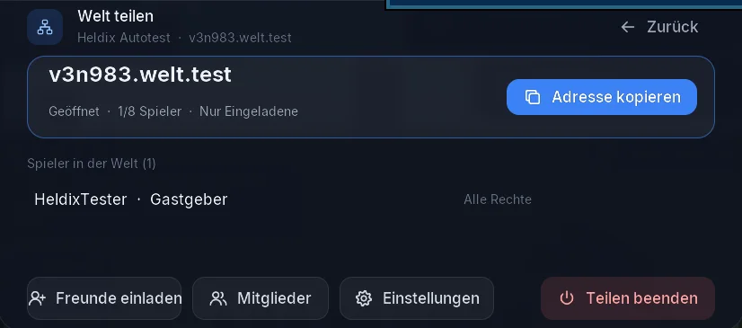
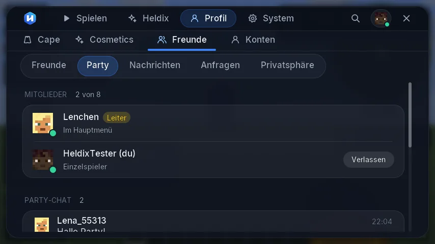
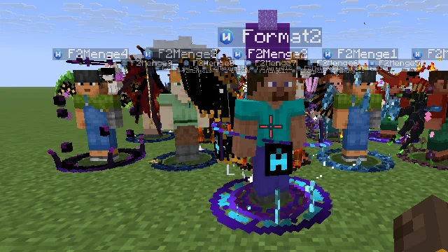
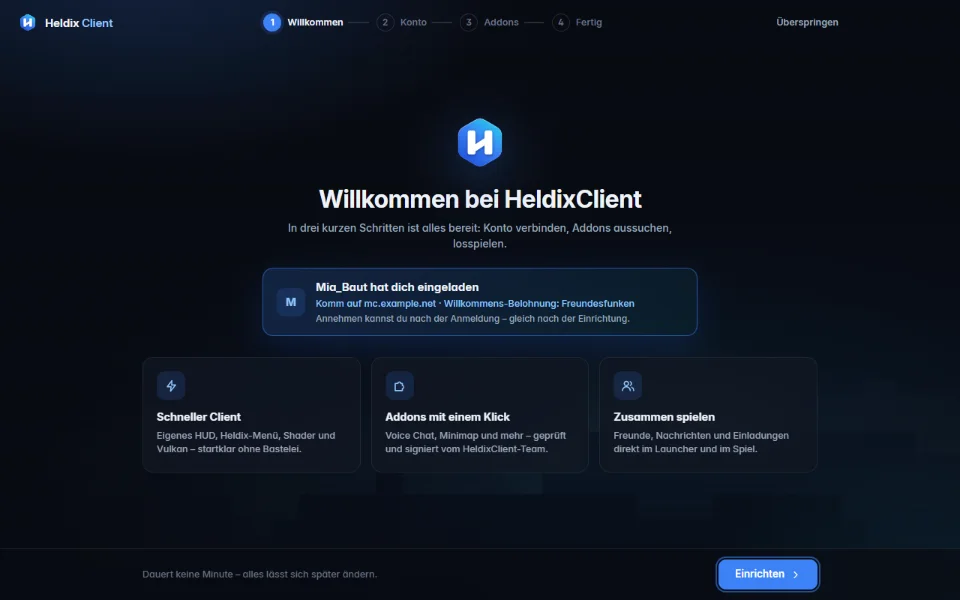
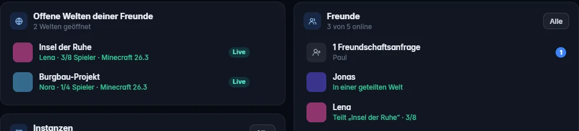
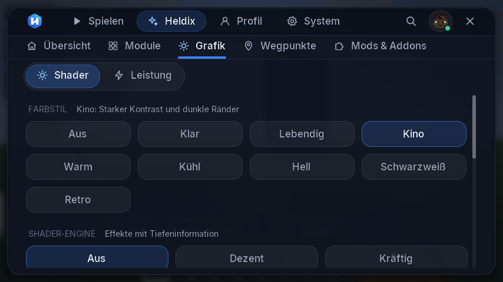

<div align="center">


# HeldixClient

**Der Minecraft-Client zum Zusammenspielen – mit eigenem Launcher, eigenem Mod-Loader, Freunden, geteilten Welten, Voice Chat und Addon-Store.**

[](https://github.com/AMDRyzen753/HeldixClient/actions/workflows/build.yml)
[](LICENSE)


[**Download**](https://heldixclient.com/download) · [Webseite](https://heldixclient.com) · [Hilfe](https://heldixclient.com/hilfe) · [Für Entwickler](https://heldixclient.com/entwickler)


</div>

## Auf einen Blick

| | |
| --- | --- |
| 🤝 **Zusammen spielen** | Freunde, Nachrichten, Party und „Beitreten“ – im Spiel, im Launcher und im Browser |
| 🌍 **Welt teilen** | Die eigene Einzelspielerwelt mit einem Klick öffnen – kostenlos, ohne Portfreigabe, mit fester Adresse für alle |
| 🎙️ **Voice Chat** | Sprechen in der Nähe, in Gruppen und in der Party; Freunde ohne HeldixClient reden im Browser mit |
| 🖥️ **Eigene Oberfläche** | Startseite, Menüs, Pausemenü, HUD-Editor, Shader und F3-Menü im Heldix-Design |
| ✨ **Cosmetics & Capes** | Animierte Flügel, Begleiter, Auren, Hüte und Capes – für alle HeldixClient-Spieler sichtbar |
| 🧩 **Addon-Store** | Minimap, Emote-Rad, Spotify und mehr – geprüft und signiert, mit einem Klick installiert |

## Was steckt drin?

| Teil | Was er macht |
| --- | --- |
| **Launcher** | Lädt Minecraft direkt von Mojang, verwaltet Instanzen und Microsoft-Konten und startet das Spiel. Electron + TypeScript. |
| **Heldix Loader** | Ein eigener Mod-Loader: klinkt sich als Java-Agent beim Start ein, verändert Minecraft-Klassen per ASM und lädt Heldix-Mods. Als Fabric-Mod läuft er auch in Fabric-Instanzen mit. |
| **HeldixClient-Mod** | Die Features im Spiel: eigene Oberfläche, HUD-Module, Zoom, Freelook, Wegpunkte, Shader, Freunde, Welt teilen, Cosmetics. |
| **Heldix-Addons** | Erweiterungen über eine stabile API, die nach Minecraft-Updates ohne neuen Build weiterlaufen – aus dem Addon-Store. |
| **Heldix-Dienst** | Der Server hinter allem: Freunde, Nachrichten, Party, Welt-Relay, Voice, Cosmetics-Katalog, Addon-Store, Updates, Webseite mit Konto und Team-Bereich. Node.js, mit einem Ein-Befehl-Installer. |

Wer Fabric-Mods wie Sodium oder Shaderpacks nutzen möchte, legt im Launcher eine **Fabric-Instanz** an – HeldixClient läuft dort mit (abschaltbar).

## Funktionen

### Zusammen spielen
- **Freunde** mit Anfragen, Online-Status, Favoriten, Spitznamen und Notizen (nur für dich), eigenem Status mit „Nicht stören“, „zuletzt online“ und einer Profilkarte mit 3D-Skin und gemeinsamen Freunden
- **Beitreten:** Spielt ein Freund auf einem öffentlichen Server oder in einer geteilten Welt, bringt dich ein Klick dorthin – aus dem Spiel, dem Launcher und dem Discord-Status
- **Nachrichten** mit Antworten, Reaktionen, „schreibt …“, Löschen und Beitreten-Karten; Einblendung im Spiel
- **Party** mit bis zu 7 Freunden: sehen, wo jeder spielt, Party-Chat, dem Leiter folgen und automatisch eine gemeinsame Voice-Gruppe
- **Welt teilen:** Einzelspielerwelt im Pausemenü öffnen, feste Adresse wie `k7m2xq.welt.heldixclient.com`, auch für Spieler ohne HeldixClient. Die IP-Adressen der Mitspieler sieht der Gastgeber nicht. Dazu **Heldix-Welten** im Hauptmenü mit den Welten der Freunde, Mitgliedern, Rollen, Anklopfen (**H**/**N**) und automatischen Sicherungen. In der Serverliste deiner Mitspieler steht „Geteilt mit HeldixClient“
- **Einladen:** eigener Link – wer darüber dazukommt, ist gleich befreundet; Belohnungen für bestätigte Freunde. Der Link kann direkt auf deinen Server führen
- **Voice Chat** (Addon): Nähe, Gruppen, Party und geteilte Welten; Mikrofon und Ton auch im Pausemenü schalten; Gäste im Browser über einen Gast-Link
- **Blockieren** und **Melden**, Privatsphäre-Einstellungen für alles, was Freunde sehen

### Im Spiel
- **Eigene Oberfläche:** moderne Schrift (Inter), weiche Flächen, eigenes Icon-Set, eigener Ladebildschirm mit Tipp-Karte
- **Startseite** mit deiner Spielfigur, „Weiterspielen“ samt Live-Stand des letzten Servers (Spieler online, Ping), Kacheln für Einzelspieler, Mehrspieler, Heldix-Welten und Realms, „Zuletzt gespielt“ und Freunden
- **Ein Fenster für alles:** Einzelspieler, Mehrspieler, Heldix-Menü (**Rechte Umschalttaste**) und Pausemenü teilen sich eine Seitenleiste; Schnellsuche, volle Tastatur-Bedienung
- **Pausemenü** mit Servername und Adresse, echtem Ping, bis zu zwölf Schnellschaltern, Voice-Schaltern, Freunden mit „Freunde einladen“, Party und Wegpunkten; das klassische Pausemenü bleibt einen Klick entfernt
- **HUD-Module:** FPS, CPS, Ping, Koordinaten, Richtung, Biom, Keystrokes, Rüstung, Trank-Effekte – frei platzierbar im **HUD-Editor** (Einrasten, Raster, Größe, Rückgängig)
- **Dauersprint und Dauerschleichen**, **Freelook** (Linke Alt), **Zoom** (C), **Fadenkreuz-Editor**, **Wegpunkte** (B, mit Todespunkt), Chat mit Uhrzeit und Zusammenfassung gleicher Nachrichten
- **Heldix-Shader:** acht Farbstile und eine Shader-Engine mit Bloom, Tiefenunschärfe, Nebel und SSAO – mit Vulkan und OpenGL
- **Leistung:** Vulkan als Standard ab Minecraft 26.x, FPS-Boost, weniger FPS im Hintergrund, F3-Menü im Heldix-Design
- **Abzeichen** für Team-Rollen, Addon-Entwickler und Community (Partner, Creator, Botschafter) in der Tab-Liste, über Köpfen und in der Freundesliste

Freelook und andere Komfort-Funktionen bleiben auf Servern aus, deren Regeln sie verbieten. Im Zweifel die Regeln des Servers prüfen.

### Cosmetics und Capes
- **13 animierte Heldix-Capes** in hoher Auflösung, die wie Stoff wehen; eigene Bilder per Drag & Drop; dasselbe Motiv auf der Elytra in echter Flügelform
- **Cosmetics** aus dem signierten Katalog: Hüte, Flügel und Rückenteile, Begleiter und Auren – viele animiert, sie reagieren auf Laufen, Schleichen, Schwimmen und Fliegen und leuchten teils im Dunkeln
- Für alle HeldixClient-Spieler sichtbar; Auswahl auch im Launcher und auf der Webseite mit 3D-Vorschau

### Addons
- **Addon-Store** im Launcher, im Spiel und auf der Webseite: Voice Chat, Minimap, Emote-Rad, Item Physics, Uhrzeit & Spielzeit, Spotify
- Addons von Entwicklern werden vom Team geprüft und signiert; der Client lädt nur Signiertes aus dem Store
- Eine stabile [Addon-API](docs/addons.md) ohne Minecraft-Abhängigkeit – Addons laufen über Minecraft-Updates hinweg weiter

### Launcher
- **Einrichtung beim ersten Start:** Willkommen (mit Einladung, falls vorhanden), Microsoft-Anmeldung und offizielle Addons zum Vorinstallieren; Windows-Installer im HeldixClient-Design
- **Instanzen** für jede Minecraft-Version mit drei Loadern: Heldix Loader, Fabric oder Vanilla; Fabric-Mods und Shaderpacks direkt von Modrinth, Leistungs-Paket mit einem Klick, Prüfung auf unverträgliche Mods
- **Mehrere Microsoft-Konten**, Wechsel auch im Spiel; Tokens mit Windows-DPAPI verschlüsselt; passendes Java (8 bis 25) wird automatisch geladen
- **Startseite** mit 3D-Skin, Weiterspielen (Quick Play), offenen Welten der Freunde, Freunden online, Patch-Notes und einer Glocke für alle Benachrichtigungen; bleibt während des Spiels auf Wunsch im Infobereich
- **Discord-Status** mit Dimension, Spielmodus, Spielerzahl, Voice, geteilter Welt, Party und eigenem Minecraft-Kopf – jeder Teil einzeln abschaltbar
- **Automatische Updates:** Windows prüft beim Start und installiert neue Versionen still; jede Version ist signiert, angenommen werden nur geprüfte, neuere Installer

### Webseite und Konto
- **Konto auf heldixclient.com** ohne Passwort – aus Launcher oder Spiel schon angemeldet: Profil und Cosmetics, Freunde, Nachrichten und Party in Echtzeit, Meine Welten, Einladen, Privatsphäre, Support, alle Daten als Datei und Konto löschen
- **Team-Bereich** mit Zwei-Faktor-Anmeldung und Rechten je Rolle (Admin, Entwickler, Moderator, Supporter, Designer, Tester): Meldungen, Support, Spieler, Neuigkeiten, Updates, Addons, Cosmetics, Abzeichen, Protokoll
- Öffentliche Seiten: Download, Module, Cosmetics, Addon-Store, Welt-Seite `/welt#code`, Neuigkeiten mit Versionsverlauf, Status, Hilfe und Entwickler-Doku

## Screenshots

| | |
| :---: | :---: |
|  |  |
| Hauptmenü | Pausemenü |
|  |  |
| Welt teilen | Party |
|  |  |
| Animierte Cosmetics | Die Heldix-Capes |
|  |  |
| Heldix-Menü | HUD-Editor |
|  |  |
| Einrichtung beim ersten Start | Offene Welten der Freunde im Launcher |
|  |  |
| Shader | Ladebildschirm |

## Installation

**Windows 10 und 11**
1. Den Installer `HeldixClient-Setup-<version>.exe` auf [heldixclient.com/download](https://heldixclient.com/download) herunterladen und starten.
2. Windows SmartScreen warnt beim ersten Start, weil der Installer nicht signiert ist: **Weitere Informationen** → **Trotzdem ausführen**.
3. Die Einrichtung führt durch Anmeldung und Addons – danach eine Instanz wählen und **Spielen** drücken.

**macOS 11 oder neuer** (Apple Silicon und Intel)
1. Auf [heldixclient.com/download](https://heldixclient.com/download) die Mac-Version laden (Apple Silicon für M1 und neuer, sonst Intel), öffnen und HeldixClient in **Programme** ziehen.
2. Die App ist nur ad-hoc signiert und nicht von Apple beglaubigt. Beim ersten Start blockiert macOS sie; unter **Systemeinstellungen → Datenschutz & Sicherheit** steht dann **Dennoch öffnen**.
3. Anmelden und spielen wie unter Windows. Unterschiede: kein Vulkan (Minecraft wählt die Grafik selbst), Updates meldet der Launcher nur und schickt zur Download-Seite, und das Spotify-Addon braucht Windows.

> [!NOTE]
> Die Anmeldung mit Microsoft-Konten braucht eine App-ID, die Mojang freigeschaltet hat. Die App-ID von HeldixClient ist freigegeben. Wer einen eigenen Build mit eigener App-ID ausliefert, muss sie selbst freischalten lassen, siehe [docs/einrichtung.md](docs/einrichtung.md).

## Selbst bauen

Voraussetzungen: Windows oder macOS, [Node.js](https://nodejs.org) 22 oder neuer und ein JDK 25 (z. B. [Temurin](https://adoptium.net)).

```powershell
git clone https://github.com/AMDRyzen753/HeldixClient.git
cd HeldixClient\launcher
npm install
npm run mod      # Heldix Loader und Client-Mod (Addons: npm run addon -- <id>, siehe docs/addons.md)
npm start        # Launcher im Entwicklungsmodus
npm run dist     # Windows-Installer in launcher\release\
npm run dist:mac # nur auf einem Mac: DMG und ZIP für Apple Silicon und Intel
```

- **Ohne Mac:** GitHub Actions baut bei jedem Push auf `main` den Windows-Installer und die Mac-App (Workflow „Build“, Artefakte `HeldixClient-Setup` und `HeldixClient-macOS`), bei einem Versions-Tag wie `v0.13.9` auch als Release. Von Hand: Workflow „Build“ → **Run workflow**.
- Beim ersten Bauen lädt Gradle die Minecraft-Client-JAR zum Kompilieren direkt von Mojang. Sie landet nur in `mod/.gradle/` und wird nie eingecheckt oder ausgeliefert.
- `mod/src/main/resources/heldix-store-key.pem` ist der **öffentliche** Schlüssel für Store-Addons und Cosmetics und muss zu `launcher/src/main/update-public-key.ts` passen. Private Schlüssel gehören nie ins Repository.
- Den **Heldix-Dienst** samt Webseite baut `npm run installer` in `service/` zu einem Ein-Befehl-Installer für Linux-Server, siehe [docs/dienst.md](docs/dienst.md).

Mehr dazu, inklusive Tests (automatischer Test im echten Spiel, Dienst- und Launcher-Tests) und Releases, steht in [docs/entwicklung.md](docs/entwicklung.md).

## Projektaufbau

```
launcher/                  Electron-Launcher (TypeScript)
├── src/main/              Hauptprozess: Fenster, Konten, Einstellungen, Discord, Updates
│   └── core/              Kern: Download, Java, Instanzen, Spielstart, Freunde, Einladungen
├── src/renderer/          Oberfläche (HTML/CSS/TypeScript)
└── src/scripts/           Release, Spielstart- und Autotest, Launcher-Tests
mod/                       Java-Projekte (Gradle, Minecraft 26.3, Java 25)
├── heldix-loader/         Heldix Loader (Java-Agent + ASM)
├── heldix-loader-fabric/  derselbe Loader als Fabric-Mod
├── heldix-api/            API für Heldix-Addons (ohne Minecraft-Abhängigkeit)
├── src/                   HeldixClient-Mod
├── addons/                offizielle Addons: voicechat, minimap, emoterad, itemphysics, uhrzeit, spotify
└── autotest/              automatischer Test im echten Spiel
service/                   Heldix-Dienst (Node.js) und Server-Installer
website/                   Webseite: öffentliche Seiten, Konto, Team-Bereich, Hilfe, Entwickler-Doku
docs/                      Dokumentation und Bilder
```

## Dokumentation

| Thema | Inhalt |
| --- | --- |
| [Heldix Loader](docs/heldix-loader.md) | Wie der Loader funktioniert, seine API und wie man eine Heldix-Mod schreibt |
| [Heldix-Addons](docs/addons.md) | Addons gegen die Heldix-API schreiben, einreichen und veröffentlichen |
| [Heldix-Dienst](docs/dienst.md) | Freunde, Welt teilen, Voice, Cosmetics, Store, Schnittstellen, Datenschutz und Installation auf dem Server |
| [Einrichtung](docs/einrichtung.md) | Microsoft-Login und Discord-Status für eigene Builds einrichten |
| [Kontowechsel](docs/konto-wechsel.md) | Wie Launcher und Spiel Konten wechseln |
| [Leistung](docs/leistung.md) | Vulkan, Java-Einstellungen, FPS-Boost, Shader, F3-Menü und Messwerte |
| [Entwicklung](docs/entwicklung.md) | Bauen, Testen, Releases, neue Minecraft-Versionen, Datenordner |

## Mitmachen

Fehler und Ideen gerne als [Issue](https://github.com/AMDRyzen753/HeldixClient/issues) melden oder im Spiel und auf der Webseite über **Hilfe & Support**. Wie du Änderungen beisteuerst, steht in [CONTRIBUTING.md](CONTRIBUTING.md).

## Rechtliches und Datenschutz

HeldixClient ist **kein offizielles Minecraft-Produkt** und steht in keiner Verbindung zu Mojang oder Microsoft.

- Alle Minecraft-Dateien lädt der Launcher direkt von Mojang. Dieses Repository enthält und verteilt keine Minecraft-Dateien.
- Der Heldix Loader verändert Minecraft-Klassen nur beim Start im Arbeitsspeicher und speichert sie nicht.
- Die Logos von Minecraft (Grasblock) und Fabric auf den Instanz-Kacheln liest der Launcher aus den Dateien im Datenordner (Minecraft-Client bzw. Fabric Loader). Sie gehören ihren Rechteinhabern und liegen nicht in diesem Repository.
- Was der Heldix-Dienst speichert und wer was sieht, steht in der [Datenschutzerklärung](https://heldixclient.com/datenschutz) und in [docs/dienst.md](docs/dienst.md). Alles lässt sich im Spiel oder auf der Webseite als Datei herunterladen und löschen.

Der Quellcode steht unter der [MIT-Lizenz](LICENSE). Die Schrift [Inter](https://github.com/rsms/inter) (in der Client-Mod und auf der Webseite) steht unter der SIL Open Font License 1.1, siehe [Inter-OFL.txt](mod/src/main/resources/licenses/Inter-OFL.txt).
